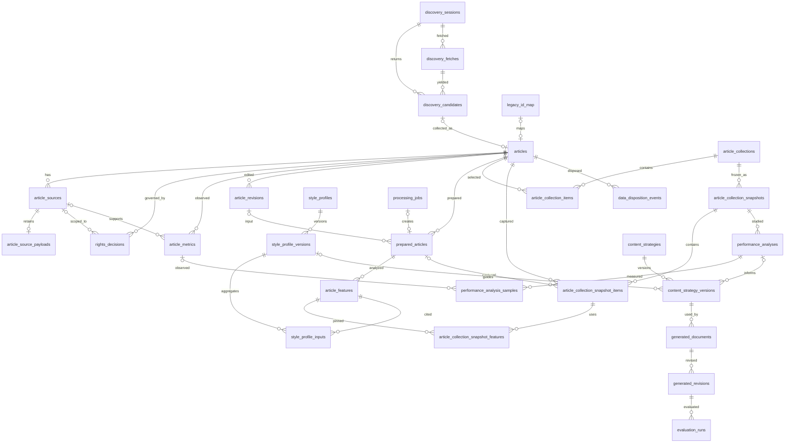

<!-- 2026-10-24：本次修改原因：以当前代码与历史数据审计为依据，定义 AI4Geo 从候选发现到评估的目标架构和可审查迁移路径。 -->
# AI4Geo 全面重构蓝图

> 状态：Stage 1 架构修订，2026-10-24。本文是实施契约，不表示数据库、代码、测试或第三方接口已经按新方案运行。Stage 2 从 2A/2B/2C 分批实施；真实业务库的破坏性切换另需备份、预检与明确确认。修订记录见 [Architecture-Decision-Review](Architecture-Decision-Review.md)。

## 1. 依据、现状与决策边界

本次阅读了根目录 `README.md`、`docs/article-library.md`、`docs/article-library/01-current-implementation-audit.md`、`02-redfox-api-field-mapping.md`、`03-article-data-model.md`、`04-cleaning-pipeline.md`、`05-database-migration.md`、`06-test-and-acceptance-report.md`，规划目录 `D:\noteSpace\Lee4More\09-Projects\电商\GEO：AI 内容运营自动化\` 下的 `README.md`、`文章库模块.md`、`Skills以及操作链规划.md`、`内容生成模块.md`，以及下列实际源码：`backend/app/db.py`、`backend/app/main.py`、`backend/app/worker.py`、`backend/app/redfox_service.py`、`backend/app/redfox_discovery_service.py`、`backend/app/api/v1/redfox.py`、`article_library.py`、`content.py`、`tasks.py`、`backend/app/strategy_service.py`、`backend/requirements.txt`、`frontend/package.json`、`frontend/src/WorkspaceApp.tsx`、`frontend/src/articleLibraryApi.ts`、`frontend/src/pages/ArticlesPage.tsx`、`SamplesPage.tsx`、`frontend/src/components/ArticleEditorDialog.tsx`。上一阶段的六份文档保留**已证实事实**；其中“保留 `content_samples` 为永久文章主表”等实施建议不作为本轮约束。

当前是 **React 19 + TypeScript 6 + Vite、FastAPI + SQLAlchemy、SQLite** 的本地工作台。数据库 `backend/data/tasks.db` 由启动时 `create_all` 和定点 `ALTER TABLE` 演进，尚无版本化迁移。`content_samples`、`article_metadata`、`article_metrics` 分摊一篇文章；`article_features` 和 `style_profiles` 直接或间接依赖旧正文；策略持有样本 ID；生成任务由单独 Python Worker 轮询 `tasks`。前端 `ArticlesPage` 同时承载文章管理、发现、风格画像；发现组件切走即卸载。RedFox 查询服务仅有约 5 分钟进程内缓存，`candidate_drafts` 只能保存补齐草稿，不能恢复完整查询会话和候选列表。

截至前次只读审计，本机库有 **11 篇样本、11 条元数据、11 条指标快照、0 条单篇特征、0 个画像、3 个均标为 `deleted` 的策略**；策略历史样本引用合计 10 项。11 条来源资料均经过白名单，**不是完整原始响应**；当前解析可能截断候选摘要至 500 字、正文至 30,000 字，HTML 结构已经丢失。这些数字是该本机库的时点快照，实施前必须重新预检。保留既有品牌库、选项配置、LLM 配置和已生成稿件能力。

### 关键架构决策

| 问题 | 决策 | 依据与边界 |
|---|---|---|
| 是否继续 SQLite | **继续**。单用户本机部署使用 FastAPI + 一个后台 Worker；两者都可以写库，必须协调短写事务、WAL、`busy_timeout`、乐观锁和任务租约。 | 不因重构换库；使用 SQLAlchemy 通用类型、UTC 时间和显式事务，避免 SQLite 专有业务 SQL。多 Worker、高并发采集或远程多人部署再评估 PostgreSQL；WAL 不能消除单写者限制。 |
| 候选是否独立建表 | **建立 `discovery_sessions` + `discovery_candidates`**，正式文章只在 `articles`。 | 返回发现页可恢复查询和补齐草稿；默认会话保留 7 天，用户明确保留可延长；过期未保留候选清理。候选不是永久正式文章，收录后来源转入不可变 `article_sources`。 |
| 每个分析阶段是否独立存储 | **分开存储**：`article_sources/articles/revisions`、`prepared_articles`、`article_features`、`style_profile_versions`、`performance_analyses`、`content_strategy_versions`。 | 输入、生命周期、版本与失效规则不同；生成稿、评估结果也独立。JSON 只容纳阶段内部结构化结果与字段溯源，不代替实体关系。 |
| 旧 `content_samples` 的地位 | 新 `articles` 为唯一正式文章主表，旧 ID 通过 `legacy_id_map` 迁移。 | 过渡期可以只读对照；切换后不得双写、双主模型长期并行。旧接口和重复表单在引用切换完成后退役。 |
| 部署形态 | 保持 Python/React **模块化单体**及独立 Worker。 | 当前规模无需微服务；API、任务、Provider 通过领域契约解耦，后续可迁移数据库或 Worker。 |

RedFox 关键词页的文档与示例对 `content` 是否稳定返回不一致；10W+ 和原创爆款指定官方页在前次审计时不可读取。三接口的具体字段以 [既有字段映射](../article-library/02-redfox-api-field-mapping.md) 的证据等级和后续真实脱敏 Fixture 为准。**不得调用付费接口补证据**；没有 Fixture 的字段保持“待验证”。

## 2. 领域边界与稳定数据流

```text
Reference Library：查询会话 → 候选 → 人工核对/批量收录 → 正式文章 + 不可变来源 + 指标快照 → 本地清洗版本
Content Intelligence：已准备文章 → 单篇特征 → 冻结集合 → 风格画像 / 表现分析 → 经审核策略版本
Content Studio：策略版本 + 品牌事实版本 + 创作要求 → 生成任务 → 原稿与人工修订
Evaluation：生成稿版本 + 画像/策略版本 → 多维评估 + 人工审核 → 发布决策
Infrastructure：迁移、Provider、权限门禁、持久任务、日志与追踪
```

品牌库仍是独立领域。Studio 只通过 `BrandSnapshot`（品牌 ID、版本、已审核事实及来源）读取；未审核事实不进入生成。文章资产、生成稿件和发布后反馈是三类不同对象；来源文章的阅读/点赞快照不得写成生成稿的效果。采集 Adapter 不能清洗或调用 LLM；Cleaner 不能生成语义风格结论；特征任务必须消费输入 Hash 匹配的 Prepared Article；风格画像与传播表现分析分别产出，画像不能替代策略，策略不能替代 Skill/Prompt。

`platform_id` 是来源平台；`category_id` 是项目内容类目；`source_category` 是接口榜单分类；`genre_id` 是体裁；`topic` 是主题；`article_collections` 是研究选样范围。这些概念有独立字段，不自动互相推断。可比传播表现仅在同平台、相近内容与时间及账号规模等有依据时计算；否则为 `unknown`。

## 3. 目标 ERD 与字段约束



### 3.1 文章、来源、指标

`articles` 保存当前确认可编辑值：平台、项目类目、既有内容形式、体裁、受众、主题、标签、标题、摘要、正文、作者、发布时间（保留时区/精度）、文章 URL、复核状态、完整性状态、当前修订号、当前字段溯源及并发版本。既有 `format_id` 暂作为 `content_format_id` 保留，**不自动改称体裁**；体裁未知则为空。允许先收录信息不全的文章并标记 `needs_review`。文章当前值是编辑工作区，不冒充原始接口事实；修订快照是某次人工确认值的审计凭据；`article_sources` 的元数据和 `article_source_payloads` 中受保留政策约束的原始项目/正文共同构成采集事实凭据，普通编辑永不覆盖。若两份来源冲突，保留两份并显式选择当前值及来源。候选补齐草稿在正式收录前不是文章权威值。删除正式文章采用业务删除状态与清理流程；已发布策略和历史报告持有版本快照，不直接悬空。

**字段级溯源。** Adapter 为每个标准字段产出 `field_provenance_json`：来源种类（`provider/manual/legacy/derived`）、`source_id` 或候选 ID、已验证的 JSON 路径、变换名称/版本、`mapped/missing/explicit_null/approximate/truncated/manual_override/legacy_unknown` 状态以及原值摘要或 Hash。候选保留初始映射；收录时把候选 ID 解析为正式来源 ID；当前文章、每次修订和指标快照分别保留其字段溯源。人工覆盖创建新溯源并指向旧来源，不修改来源载荷。未验证的 RedFox 路径只能标待验证，不能硬编码成已确认。原始 JSON 在许可保留期间保留所有未知键；正文不在 provenance 中重复全文，只存路径、长度、Hash 和是否截断。详情 API 可显示字段来源、人工覆盖和解析警告。

例如尚未用真实响应验证字段路径时，内部记录可以是 `{ "read_exact": { "origin":"provider", "source_id":"source_001", "source_path":null, "path_verification":"pending", "transform":"parse_count@1", "status":"approximate", "raw_value":"10w+", "lower_bound":100000 } }`；这里的 `source_001` 和读数仅演示结构，不证明任何 RedFox 端点实际返回该字段。用户补写作者后，该字段的当前 provenance 改为 `origin=manual/status=manual_override/revision_id=...`，原 Provider 记录仍可追溯。

**值语义。** 缺键与上游显式 `null` 分开；真实 `0` 不转为空；`"10w+"` 保留原值和下界，精确值为 NULL；无法解析保留原值和警告；列表预览截断不代表持久存储截断；确实被上游或旧代码截断须标 `truncated`，不可标全文完整。空字符串按字段规则保留或经明确规范化转空并记录变换。来源值不会因候选/编辑表单未展示而被 PATCH 清空。

`discovery_fetches` 按每次上游请求保存脱敏参数、原始响应包及分页元数据；`discovery_candidates` 保存其中完整单条响应 JSON、Adapter 标准字段、字段溯源、可编辑补齐草稿、完整性和收录状态。现有其他平台发现接口有“热点/话题”结果，候选须标 `candidate_kind=topic`，取得具体文章并核对后才可转为 `article` 收录，不能把话题标题冒充文章。摘要/正文的列表预览可截断，存储不可静默截断；超出配置容量时返回可定位错误，保留原采集错误，不宣称已收录。候选收录事务将原始项目复制到 `article_source_payloads`，把不含其他文章正文的响应元信息写入 `article_sources`，创建或关联 `articles`，新增观测快照和字段溯源，并记 `collected_article_id`；以后清理候选不影响正式来源。手动录入在同一事务建立 `articles` 和 `provider=manual` 来源，无伪造 RedFox 响应。来源项目只读、密钥脱敏、保留解析器版本和警告；再次发现同一文章追加来源/指标，不能让空字段覆盖已确认值。

去重顺序：同 Provider + Endpoint + 外部 ID、规范化文章 URL、人工确认的合并建议。`workUuid` 与 `photoId` **不视为同一 ID 命名空间**。正文 Hash 仅说明文本相等，不单独决定两个发布记录是同一篇。冲突时返回候选匹配列表供人合并；合并记录动作与目标 ID，策略/集合引用重定向必须在一个事务完成。`article_metrics` 按观测时间追加，保留所有原值：`"12345"→read_exact=12345`；`"10w+"→read_raw="10w+", read_exact=NULL, read_lower_bound=100000`；缺失为 NULL，真实 0 为 0；无法解析保留原值并写警告。来源粉丝数、收藏、打赏、互动总数在原始项目和扩展指标中保留，不用零填补。人工修正指标追加 `manual` 快照，不改写旧观测。

### 3.2 清洗、特征与版本失效

`article_revisions` 每次人工修改形成不可变快照，记录变更字段、来源溯源和编辑原因；`articles` 仅保存当前值。`prepared_articles` 只读取已持久化的当前修订或原始来源，记录输入引用、正文格式、输入 Hash、与来源身份无关的 `content_hash`、`preparation_config_hash`、Cleaner 版本、正文块和质量警告。`preparation_config_hash` 对格式检测、解析器选项、语言/去噪规则等规范化配置求 SHA-256；`input_hash` 对实际读取的标题、正文、格式及输入来源身份求 Hash。相同正文但换来源时可凭 `content_hash` 复用纯计算结果，却须建立指向新来源的 Prepared 记录，保证权限和血缘不混淆。HTML、Markdown、纯文本分别解析，保留可识别的段落、标题、引用、列表和图片位置；无法确认则 `unknown`。自动清洗不覆盖采集快照或当前文章。

`article_features` 按特征组记录结果，引用确切 Prepared ID，另存 `analysis_input_hash`、`analysis_config_hash`、分析器/模型/Prompt/Skill 版本、证据块及不确定性。配置 Hash 覆盖模型参数、Prompt、维度开关、词典/规则和依赖声明；输入 Hash 只覆盖该特征组实际依赖的 Prepared 内容及元数据。八组可以独立重用或重算；传播表现交由 `performance_analyses`，不混入写作特征。`style_profile_inputs` 引用聚合实际使用的特征版本；`style_profile_versions` 不可变，画像的 `current_version_id` 只指向人工审核通过的版本。`content_strategy_versions` 引用确切画像版本和可选的已审核表现分析；现有直接按样本提炼的策略迁为 `legacy_unverified` 草稿，不能伪造画像或单篇特征。

**按依赖判断当前有效性。** 任务提交时冻结输入引用、行版本、内容 Hash、配置 Hash 和权限决策版本；开始执行前重新检查一次。Worker 在最终短事务中比较这些值，匹配才将新结果纳入“当前有效”选择；如果输入已变化，结果仍作为历史运行记录保存并标 `superseded`，不得覆盖当前指针，也不自动再次调用付费模型。历史完成结果内容不可变；“过期”是相对于当前依赖计算的视图状态，不批量修改旧结果。当前 Prepared 由输入身份/Hash、配置 Hash、Cleaner 版本和处理完成状态选择；当前特征由特征组输入/配置指纹选择；当前画像由冻结样本快照和所引用特征版本选择。Cleaner/Analyzer/Prompt 升级只影响真实依赖它的结果。正文完整性 `complete/partial/missing/unknown` 与处理状态分离，不能单凭字数断言完整。

| 修改内容 | 本地清洗 | 单篇写作特征 | 冻结集合与画像 |
|---|---|---|---|
| 标题或正文 | 仅相应清洗输入 Hash 改变时重算 | 仅依赖变化输入的特征组重算 | 依赖这些特征版本的画像需新版本；旧版留存 |
| 作者、发布时间 | 通常不重算正文；若清洗配置显式使用则重算 | 仅声明依赖的组重算 | 分组/样本资格变化时重建快照 |
| 阅读、点赞等来源指标 | 不重算 | 不重算写作特征 | 只影响用该指标的表现分析或表现分层选样 |
| 内部类目、体裁、主题 | 不重算正文 | 仅显式依赖的组重算 | 动态集合重新筛选；冻结集合不变，新研究需新快照 |
| 来源选择 | 内容、格式或来源身份变更时建立新 Prepared；相同计算可复用 | 以实际分析输入 Hash 判定 | 来源权限或输入版本变化时重新核查资格 |

### 3.3 分级权限门禁

`rights_decisions` 追加记录文章或具体来源的使用决定、证据、适用范围、有效期和撤回关系；`articles.rights_status/rights_scope_json` 是当前显示与筛选投影，**不是比决定记录更权威的许可**。执行时综合来源条款、用户确认和最新未撤回决定；来源切换不能借另一来源的许可越权。权限未知采用保守处理，服务端每次派生任务都重新检查，不只信提交时的布尔值。

| 操作 | 门禁 | 未满足时 |
|---|---|---|
| 保存候选/原始正文 | Provider 条款及本项目保存许可允许该数据和保留期 | 不永久保存受限正文；保留允许的最小元数据与错误状态，提示核对 |
| 本地确定性清洗 | 当前文章/来源允许本地存储与加工，且正文可用 | 阻止该清洗任务；**不要求第三方 LLM 许可** |
| 第三方 LLM 特征/画像 | 本地加工许可 + 明确允许向选定服务商发送相应全文/摘要范围 | 不发送外部请求；可继续已允许的本地处理 |
| 内容生成引用 | 允许把抽象特征/画像用于生成，并核对策略引用及品牌资料范围 | 禁止在新生成任务引用；历史稿件单独按保留政策处理 |
| 对外展示/导出 | 单独的展示或再分发范围 | 隐藏受限全文和原始附件，仅保留允许的审计信息 |

权限被撤回、到期或来源条款变化时，阻止新的任务；排队任务取消，运行任务在外发前/写结果前复核。已完成 Prepared/Feature 的历史内容不自动变成有权继续使用的数据：执行第 3.5 节的清理与派生失效，涉及它们的画像和策略标“需重审”，新生成不得引用。保留 Hash/版本/操作审计不等于保留全文。具体许可事实尚未验证，不把“公开可访问”当授权。

### 3.4 动态集合、冻结样本与两类研究结果

`article_collections` 保存动态筛选规则或人工选择规则：平台、类目、体裁、主题、清洗状态、来源与表现分组可以组合。动态集合随数据变化，适合日常管理，不能直接充当可复现实验输入。运行分析前生成不可变 `article_collection_snapshots`：记录筛选/抽样配置、随机种子、分层口径、冻结时间和候选/有效/剔除计数；`snapshot_items` 锁定文章、文章修订、Prepared 版本、组标签及剔除理由；`snapshot_features` 锁定每项分析实际使用的特征 ID。冻结快照不因后续编辑而改写，重做实验建立新快照。

抽样时按可信 URL/外部 ID 去重，正文 Hash 相同但发布记录不同的只标疑似重复；记录纳入/剔除与理由。分层可按平台、体裁、主题、发布时间、账号规模和可比较表现；指标缺失、右删失 `10w+`、样本未成熟等单独分层或剔除并说明。异常值规则、阈值、随机种子和分析配置一并冻结。不能只抓爆款就声称写法导致传播。

**Style Profile** 汇总写作特征：记录候选数、有效数、剔除原因、作者与平台/体裁/主题分布、异常值处理、各维度证据覆盖率、置信提示、模型/算法版本和人工审核。样本过少、某作者占比过高或证据覆盖不足时标 `needs_review`，不强行给稳定画像。**Performance Analysis** 独立使用同口径指标快照、发表时长和可比组，记录分母及缺失比例；`10w+` 是下界/右删失观测，不能按精确 100000 求均值，可用区间/删失数据方法或只报告下界比例。StyleScore 是写法相似度，传播分析是观察性关联，不是流量预测或因果证明。策略可以分别引用已审核画像和已验证的表现分析，并写明取舍规则。

### 3.5 正式来源、派生结果与删除

候选查询包默认 7 天；被固定或有未提交草稿的会话延长，用户可解除固定。正式来源的元数据、原始正文/HTML 和图片引用只在文章活跃且权限允许期间保存；图片仅存来源引用，不默认下载二进制。配置保留期和 Provider 许可取较短者；没有已核实许可时不无限期保存原始全文。授权撤回或文章删除立即阻止读取、外发和新任务，24 小时内删除 `article_source_payloads` 对应载荷并清理活跃库的当前正文、人工修订正文、候选缓存、Prepared 文本、任务输入以及可反推原文的特征证据片段；旧结果可保留不含文本的元数据审计壳。正常分析结果不可变，**合规清理是唯一受审计的内容抹除例外**。只保留允许的最小来源标识、Hash、版本、删除事件和非内容审计。日志不得含全文；备份按独立到期策略（目标最长 30 天）淘汰，在此之前恢复备份也须重放删除事件。此为项目默认数据治理目标，不宣称替代实际 Provider 条款或法律意见。

已引用被删除/撤回文章的画像版本仍可留下**不含受限原文**的审计壳，但其当前可用性失效；策略停止新生成并待人工重审。若确有独立有效来源，先逐来源核对权限再决定能否保留派生结果，不能自动沿用。`data_disposition_events` 记录请求、依据、清理范围、完成/失败时间与残留项；`legacy_payload_archive` 和旧表只读副本也必须受同一清理清单约束。清理候选时正式 `article_sources` 不受影响，清理正式文章时则必须追踪所有衍生与备份。

### 3.6 执行级目标 DDL

下列 DDL 描述**目标业务 Schema**，用于编写 SQLAlchemy 模型和 Alembic 初版迁移；现有生产库不得直接执行这段 SQL。JSON 列在 SQLite 以 TEXT 保存并由 Pydantic 校验，未来在 PostgreSQL 迁移可转 JSONB。所有时间为 UTC ISO 8601；具体 `DateTime(timezone=True)` 和 UUID 类型由 ORM 迁移脚本跨库映射。`brands`、`content_options`、`llm_settings` 保持现有独立业务语义与数据，下面也列出其目标结构；迁移时不能在现有表上盲目 `CREATE TABLE`。

```sql
CREATE TABLE content_options (
  id TEXT PRIMARY KEY, kind TEXT NOT NULL, label TEXT NOT NULL,
  active INTEGER NOT NULL, position INTEGER NOT NULL
);
CREATE TABLE brands (
  id TEXT PRIMARY KEY, name TEXT NOT NULL, description TEXT NOT NULL,
  facts_json TEXT NOT NULL, active INTEGER NOT NULL,
  version INTEGER NOT NULL, created_at TEXT NOT NULL
);
CREATE TABLE llm_settings (
  id INTEGER PRIMARY KEY, provider TEXT NOT NULL, model TEXT NOT NULL
);
CREATE TABLE discovery_sessions (
  id TEXT PRIMARY KEY, platform_id TEXT NOT NULL, provider TEXT NOT NULL,
  endpoint TEXT NOT NULL, request_params_json TEXT NOT NULL,
  status TEXT NOT NULL, result_count INTEGER, pinned INTEGER NOT NULL DEFAULT 0,
  created_at TEXT NOT NULL, expires_at TEXT NOT NULL, last_viewed_at TEXT
);
CREATE TABLE articles (
  id TEXT PRIMARY KEY, platform_id TEXT NOT NULL, category_id TEXT,
  content_format_id TEXT, genre_id TEXT, audience_id TEXT,
  topic TEXT, tags_json TEXT NOT NULL,
  title TEXT NOT NULL, summary TEXT, body_text TEXT, author_name TEXT,
  published_at TEXT, article_url TEXT, canonical_url TEXT,
  review_status TEXT NOT NULL, content_status TEXT NOT NULL,
  rights_status TEXT NOT NULL, rights_scope_json TEXT NOT NULL,
  rights_evidence TEXT, quality_score INTEGER, current_revision_no INTEGER NOT NULL, current_revision_id TEXT,
  field_provenance_json TEXT NOT NULL, row_version INTEGER NOT NULL DEFAULT 1,
  collected_at TEXT, deleted_at TEXT, created_at TEXT NOT NULL, updated_at TEXT NOT NULL,
  FOREIGN KEY(id, current_revision_id) REFERENCES article_revisions(article_id, id)
);
CREATE TABLE discovery_fetches (
  id TEXT PRIMARY KEY, session_id TEXT NOT NULL REFERENCES discovery_sessions(id),
  request_params_json TEXT NOT NULL, raw_response_json TEXT NOT NULL,
  upstream_cursor TEXT, result_count INTEGER, has_more INTEGER,
  fetched_at TEXT NOT NULL
);
CREATE TABLE discovery_candidates (
  id TEXT PRIMARY KEY, session_id TEXT NOT NULL REFERENCES discovery_sessions(id),
  fetch_id TEXT NOT NULL REFERENCES discovery_fetches(id),
  candidate_kind TEXT NOT NULL, provider TEXT NOT NULL,
  endpoint TEXT NOT NULL, external_id TEXT,
  candidate_key TEXT NOT NULL, raw_item_json TEXT NOT NULL,
  normalized_json TEXT NOT NULL, field_provenance_json TEXT NOT NULL,
  edit_draft_json TEXT, row_version INTEGER NOT NULL DEFAULT 1,
  parser_version TEXT NOT NULL, warnings_json TEXT NOT NULL,
  content_status TEXT NOT NULL, pinned INTEGER NOT NULL DEFAULT 0,
  collected_article_id TEXT REFERENCES articles(id),
  discovered_at TEXT NOT NULL, updated_at TEXT NOT NULL,
  UNIQUE(session_id, candidate_key)
);
CREATE TABLE article_sources (
  id TEXT PRIMARY KEY, article_id TEXT NOT NULL REFERENCES articles(id),
  discovery_candidate_id TEXT REFERENCES discovery_candidates(id) ON DELETE SET NULL,
  acquisition_method TEXT NOT NULL, provider TEXT NOT NULL, endpoint TEXT,
  external_id TEXT, source_url TEXT, source_category TEXT,
  request_params_json TEXT NOT NULL, response_meta_json TEXT NOT NULL,
  field_mapping_json TEXT NOT NULL, raw_item_hash TEXT,
  raw_content_hash TEXT, content_format TEXT NOT NULL,
  raw_complete INTEGER NOT NULL, parser_version TEXT NOT NULL,
  warnings_json TEXT NOT NULL, fetched_at TEXT NOT NULL
);
CREATE TABLE article_source_payloads (
  source_id TEXT PRIMARY KEY REFERENCES article_sources(id),
  raw_item_json TEXT NOT NULL, raw_content TEXT,
  stored_at TEXT NOT NULL, retain_until TEXT
);
CREATE TABLE rights_decisions (
  id TEXT PRIMARY KEY, article_id TEXT NOT NULL REFERENCES articles(id),
  source_id TEXT REFERENCES article_sources(id), status TEXT NOT NULL,
  scope_json TEXT NOT NULL, evidence TEXT, policy_version TEXT NOT NULL,
  supersedes_id TEXT REFERENCES rights_decisions(id),
  effective_at TEXT NOT NULL, expires_at TEXT, recorded_at TEXT NOT NULL
);
CREATE TABLE article_metrics (
  id TEXT PRIMARY KEY, article_id TEXT NOT NULL REFERENCES articles(id),
  source_id TEXT REFERENCES article_sources(id), source_label TEXT NOT NULL,
  observed_at TEXT NOT NULL,
  read_raw TEXT, read_exact INTEGER, read_lower_bound INTEGER,
  likes INTEGER, watch_count INTEGER, comments INTEGER, shares INTEGER,
  saves INTEGER, rewards INTEGER, fans_count INTEGER, interactive_count INTEGER,
  impressions INTEGER, clicks INTEGER, extra_metrics_json TEXT NOT NULL,
  parse_warnings_json TEXT NOT NULL, field_provenance_json TEXT NOT NULL
);
CREATE TABLE article_revisions (
  id TEXT PRIMARY KEY, article_id TEXT NOT NULL REFERENCES articles(id),
  revision_number INTEGER NOT NULL, title TEXT NOT NULL, summary TEXT,
  body_text TEXT, author_name TEXT, published_at TEXT,
  category_id TEXT, content_format_id TEXT, genre_id TEXT, article_url TEXT,
  snapshot_json TEXT NOT NULL, field_provenance_json TEXT NOT NULL,
  edited_fields_json TEXT NOT NULL, editor_note TEXT,
  created_at TEXT NOT NULL, UNIQUE(article_id, revision_number),
  UNIQUE(article_id, id)
);
CREATE TABLE prepared_articles (
  id TEXT PRIMARY KEY, article_id TEXT NOT NULL REFERENCES articles(id),
  article_revision_id TEXT REFERENCES article_revisions(id),
  source_id TEXT REFERENCES article_sources(id), input_origin TEXT NOT NULL,
  input_ref_id TEXT NOT NULL, input_format TEXT NOT NULL,
  input_hash TEXT NOT NULL, content_hash TEXT NOT NULL,
  preparation_config_hash TEXT NOT NULL,
  cleaner_version TEXT NOT NULL,
  reused_from_prepared_id TEXT REFERENCES prepared_articles(id),
  clean_title TEXT, clean_text TEXT, blocks_json TEXT NOT NULL,
  keywords_json TEXT NOT NULL, quality_flags_json TEXT NOT NULL,
  content_status TEXT NOT NULL, status TEXT NOT NULL,
  created_at TEXT NOT NULL, completed_at TEXT, error_code TEXT,
  UNIQUE(article_id, input_origin, input_ref_id, input_hash,
         preparation_config_hash, cleaner_version)
);
CREATE TABLE article_features (
  id TEXT PRIMARY KEY, article_id TEXT NOT NULL REFERENCES articles(id),
  prepared_article_id TEXT NOT NULL REFERENCES prepared_articles(id),
  feature_group TEXT NOT NULL, analysis_input_hash TEXT NOT NULL,
  analysis_config_hash TEXT NOT NULL,
  analyzer_version TEXT NOT NULL, skill_version TEXT NOT NULL,
  reused_from_feature_id TEXT REFERENCES article_features(id),
  model_id TEXT, prompt_version TEXT, features_json TEXT NOT NULL,
  evidence_json TEXT NOT NULL, uncertainty_json TEXT NOT NULL,
  status TEXT NOT NULL, created_at TEXT NOT NULL, completed_at TEXT,
  UNIQUE(prepared_article_id, feature_group, analysis_input_hash,
         analysis_config_hash, analyzer_version)
);
CREATE TABLE article_collections (
  id TEXT PRIMARY KEY, name TEXT NOT NULL, filter_json TEXT NOT NULL,
  selection_mode TEXT NOT NULL, version INTEGER NOT NULL,
  row_version INTEGER NOT NULL DEFAULT 1,
  created_at TEXT NOT NULL, updated_at TEXT NOT NULL
);
CREATE TABLE article_collection_items (
  collection_id TEXT NOT NULL REFERENCES article_collections(id),
  article_id TEXT NOT NULL REFERENCES articles(id),
  added_at TEXT NOT NULL, PRIMARY KEY(collection_id, article_id)
);
CREATE TABLE article_collection_snapshots (
  id TEXT PRIMARY KEY, collection_id TEXT NOT NULL REFERENCES article_collections(id),
  version_number INTEGER NOT NULL, collection_version INTEGER NOT NULL,
  filter_json TEXT NOT NULL, sampling_config_json TEXT NOT NULL,
  random_seed TEXT, candidate_count INTEGER NOT NULL,
  included_count INTEGER NOT NULL, excluded_count INTEGER NOT NULL,
  frozen_at TEXT, status TEXT NOT NULL DEFAULT 'selection_building',
  sealed_at TEXT, row_version INTEGER NOT NULL DEFAULT 1,
  UNIQUE(collection_id, version_number)
);
CREATE TABLE article_collection_snapshot_items (
  id TEXT PRIMARY KEY,
  snapshot_id TEXT NOT NULL REFERENCES article_collection_snapshots(id),
  article_id TEXT NOT NULL REFERENCES articles(id),
  article_revision_id TEXT REFERENCES article_revisions(id),
  prepared_article_id TEXT REFERENCES prepared_articles(id),
  stratum_json TEXT NOT NULL, included INTEGER NOT NULL,
  exclusion_reason TEXT, UNIQUE(snapshot_id, article_id)
);
CREATE TABLE article_collection_snapshot_features (
  snapshot_item_id TEXT NOT NULL REFERENCES article_collection_snapshot_items(id),
  feature_id TEXT NOT NULL REFERENCES article_features(id),
  PRIMARY KEY(snapshot_item_id, feature_id)
);
CREATE TABLE style_profiles (
  id TEXT PRIMARY KEY, name TEXT NOT NULL, platform_id TEXT,
  genre_id TEXT, current_version_id TEXT,
  created_at TEXT NOT NULL, updated_at TEXT NOT NULL
);
CREATE TABLE style_profile_versions (
  id TEXT PRIMARY KEY, profile_id TEXT NOT NULL REFERENCES style_profiles(id),
  version_number INTEGER NOT NULL,
  collection_snapshot_id TEXT NOT NULL REFERENCES article_collection_snapshots(id),
  profile_json TEXT NOT NULL, sample_count INTEGER NOT NULL,
  valid_sample_count INTEGER NOT NULL, exclusion_reasons_json TEXT NOT NULL,
  sample_distribution_json TEXT NOT NULL, outlier_method_json TEXT NOT NULL,
  evidence_coverage_json TEXT NOT NULL, uncertainty_json TEXT NOT NULL,
  analyzer_version TEXT NOT NULL, status TEXT NOT NULL,
  reviewer_note TEXT, reviewed_at TEXT, created_at TEXT NOT NULL,
  UNIQUE(profile_id, version_number)
);
CREATE TABLE style_profile_inputs (
  profile_version_id TEXT NOT NULL REFERENCES style_profile_versions(id),
  snapshot_item_id TEXT NOT NULL REFERENCES article_collection_snapshot_items(id),
  feature_id TEXT NOT NULL REFERENCES article_features(id),
  PRIMARY KEY(profile_version_id, feature_id)
);
CREATE TABLE performance_analyses (
  id TEXT PRIMARY KEY,
  collection_snapshot_id TEXT NOT NULL REFERENCES article_collection_snapshots(id),
  analysis_config_hash TEXT NOT NULL, method_version TEXT NOT NULL,
  result_json TEXT NOT NULL, valid_sample_count INTEGER NOT NULL,
  missing_count INTEGER NOT NULL, censored_count INTEGER NOT NULL,
  exclusion_reasons_json TEXT NOT NULL, status TEXT NOT NULL,
  reviewer_note TEXT, reviewed_at TEXT, created_at TEXT NOT NULL,
  UNIQUE(collection_snapshot_id, analysis_config_hash, method_version)
);
CREATE TABLE performance_analysis_samples (
  analysis_id TEXT NOT NULL REFERENCES performance_analyses(id),
  snapshot_item_id TEXT NOT NULL REFERENCES article_collection_snapshot_items(id),
  metric_id TEXT REFERENCES article_metrics(id),
  value_semantics TEXT NOT NULL, group_json TEXT NOT NULL,
  inclusion_reason TEXT, exclusion_reason TEXT,
  PRIMARY KEY(analysis_id, snapshot_item_id)
);
CREATE TABLE content_strategies (
  id TEXT PRIMARY KEY, name TEXT NOT NULL, platform_id TEXT,
  category_id TEXT, content_format_id TEXT, audience_id TEXT, genre_id TEXT,
  current_version_id TEXT,
  created_at TEXT NOT NULL, updated_at TEXT NOT NULL
);
CREATE TABLE content_strategy_versions (
  id TEXT PRIMARY KEY, strategy_id TEXT NOT NULL REFERENCES content_strategies(id),
  version_number INTEGER NOT NULL,
  style_profile_version_id TEXT REFERENCES style_profile_versions(id),
  performance_analysis_id TEXT REFERENCES performance_analyses(id),
  rules_json TEXT NOT NULL, source_snapshot_json TEXT NOT NULL,
  skill_version TEXT, prompt_version TEXT,
  status TEXT NOT NULL, reviewer_note TEXT, published_at TEXT,
  created_at TEXT NOT NULL, UNIQUE(strategy_id, version_number)
);
CREATE TABLE strategy_article_refs (
  id TEXT PRIMARY KEY,
  strategy_version_id TEXT NOT NULL REFERENCES content_strategy_versions(id),
  article_id TEXT REFERENCES articles(id), legacy_article_id TEXT,
  title_snapshot TEXT NOT NULL, url_snapshot TEXT,
  source_provider TEXT
);
CREATE TABLE processing_jobs (
  id TEXT PRIMARY KEY, job_type TEXT NOT NULL, target_type TEXT NOT NULL,
  target_id TEXT, status TEXT NOT NULL, progress INTEGER NOT NULL DEFAULT 0,
  attempt_count INTEGER NOT NULL DEFAULT 0, max_attempts INTEGER NOT NULL,
  idempotency_key TEXT, input_hash TEXT, config_hash TEXT,
  input_versions_json TEXT NOT NULL, input_json TEXT NOT NULL,
  result_json TEXT, lease_owner TEXT, lease_until TEXT, heartbeat_at TEXT,
  row_version INTEGER NOT NULL DEFAULT 1,
  error_code TEXT, error_message TEXT, created_at TEXT NOT NULL,
  started_at TEXT, completed_at TEXT
);
CREATE TABLE generated_documents (
  id TEXT PRIMARY KEY, generation_job_id TEXT REFERENCES processing_jobs(id),
  strategy_version_id TEXT REFERENCES content_strategy_versions(id),
  brand_id TEXT REFERENCES brands(id), brand_version INTEGER, target_platform_id TEXT NOT NULL,
  topic TEXT NOT NULL, audience_id TEXT, requirements_json TEXT NOT NULL,
  strategy_snapshot_json TEXT NOT NULL, brand_snapshot_json TEXT NOT NULL,
  created_at TEXT NOT NULL
);
CREATE TABLE generated_revisions (
  id TEXT PRIMARY KEY, document_id TEXT NOT NULL REFERENCES generated_documents(id),
  revision_number INTEGER NOT NULL, origin TEXT NOT NULL,
  title TEXT NOT NULL, summary TEXT, body_markdown TEXT NOT NULL,
  provider TEXT, model_id TEXT, prompt_version TEXT,
  input_tokens INTEGER, output_tokens INTEGER, created_at TEXT NOT NULL,
  UNIQUE(document_id, revision_number)
);
CREATE TABLE evaluation_runs (
  id TEXT PRIMARY KEY, generated_revision_id TEXT NOT NULL REFERENCES generated_revisions(id),
  profile_version_id TEXT REFERENCES style_profile_versions(id),
  evaluator_version TEXT NOT NULL, dimensions_json TEXT NOT NULL,
  evidence_json TEXT NOT NULL, uncertainty_json TEXT NOT NULL,
  human_decision TEXT, status TEXT NOT NULL, created_at TEXT NOT NULL
);
CREATE TABLE legacy_id_map (
  legacy_table TEXT NOT NULL, legacy_id TEXT NOT NULL,
  target_table TEXT NOT NULL, target_id TEXT NOT NULL,
  migrated_at TEXT NOT NULL, checksum TEXT NOT NULL,
  PRIMARY KEY(legacy_table, legacy_id, target_table)
);
CREATE TABLE legacy_payload_archive (
  legacy_table TEXT NOT NULL, legacy_id TEXT NOT NULL,
  payload_json TEXT NOT NULL, payload_hash TEXT NOT NULL,
  migration_status TEXT NOT NULL, archived_at TEXT NOT NULL,
  retain_until TEXT, redacted_at TEXT,
  PRIMARY KEY(legacy_table, legacy_id)
);
CREATE TABLE data_disposition_events (
  id TEXT PRIMARY KEY, target_type TEXT NOT NULL, target_id TEXT NOT NULL,
  article_id TEXT REFERENCES articles(id),
  source_id TEXT REFERENCES article_sources(id), reason TEXT NOT NULL,
  scope_json TEXT NOT NULL, status TEXT NOT NULL,
  requested_at TEXT NOT NULL, completed_at TEXT, error_summary TEXT
);
CREATE INDEX ix_discovery_session_expiry ON discovery_sessions(expires_at, pinned);
CREATE INDEX ix_discovery_fetch_session ON discovery_fetches(session_id, fetched_at);
CREATE INDEX ix_candidate_collected ON discovery_candidates(collected_article_id);
CREATE UNIQUE INDEX ux_source_candidate ON article_sources(discovery_candidate_id)
  WHERE discovery_candidate_id IS NOT NULL;
CREATE INDEX ix_article_filter ON articles(platform_id, category_id, genre_id, deleted_at);
CREATE UNIQUE INDEX ux_article_canonical_url ON articles(platform_id, canonical_url)
  WHERE canonical_url IS NOT NULL AND deleted_at IS NULL;
CREATE INDEX ix_source_identity ON article_sources(provider, endpoint, external_id);
CREATE INDEX ix_metrics_history ON article_metrics(article_id, observed_at);
CREATE INDEX ix_rights_article ON rights_decisions(article_id, effective_at);
CREATE INDEX ix_snapshot_items ON article_collection_snapshot_items(snapshot_id, included);
CREATE INDEX ix_performance_analysis ON performance_analyses(collection_snapshot_id, status);
CREATE INDEX ix_disposition_status ON data_disposition_events(status, requested_at);
CREATE INDEX ix_strategy_article_refs ON strategy_article_refs(strategy_version_id, article_id);
CREATE INDEX ix_prepared_current ON prepared_articles(article_id, status, created_at);
CREATE INDEX ix_jobs_poll ON processing_jobs(status, lease_until, created_at);
CREATE UNIQUE INDEX ux_job_idempotency ON processing_jobs(job_type, idempotency_key)
  WHERE idempotency_key IS NOT NULL;
```

DDL 中的部分索引是 SQLite/PostgreSQL 均支持的目标表达，迁移脚本应通过 SQLAlchemy/Alembic 方言适配。`current_version_id` 的循环外键在数据库创建后用迁移约束或服务层加目标版本所属校验；只允许指向同一主记录的已审核版。`prepared_articles.input_ref_id` 必须与 `input_origin=revision|source` 对应的非空 FK 相等，且引用与 `article_id` 一致；`article_features`、冻结项、画像输入、表现样本各自引用的文章/快照也必须属于同一链路。SQLite 单列 FK 不能保证这些跨表同属关系，**服务层在单事务内验证，迁移验证脚本复查**。所有 `*_json` 列由 Pydantic Schema 校验；`processing_jobs.target_type/id` 是任务定位符，不依赖数据库跨多表外键。`discovery_fetches.raw_response_json` 只在候选保留期限内保存，正式来源原始项目保存在可清除的 `article_source_payloads`；业务正常编辑不更改载荷。DDL 是目标结构说明，执行迁移时由 Alembic 生成并在备份副本演练，不允许在真实库直接照抄运行。

<!-- 2026-10-24：本次修改原因：把首次创建修订、冻结分析输入与敏感数据清理的实际 Stage 2A 约束嵌入数据模型章节。 -->
文章创建和编辑在同一事务中写修订并更新 `current_revision_id/current_revision_no`；组合外键保证当前修订属于该文章，`row_version` 比对防并发覆盖。研究快照依次经过 `selection_building → selection_frozen → analyzing → inputs_sealed`：冻结后选样项不可变，分析时只追加已核对的特征关联，封存后关联不可变且画像才可使用该输入。`data_disposition_events.target_type/target_id` 可指向文章、候选或任务；旧归档另有保留及脱敏时间。Stage 2A 的 SQLite 迁移用触发器保护集合状态，未来 PostgreSQL 迁移须提供等效数据库约束，不能仅靠前端禁用按钮。

| 变化 | 新表 | 新字段/约束 | 服务层规则 |
|---|---|---|---|
| 字段级来源 | 无 | 候选、文章、修订、指标的 `field_provenance_json`；来源 `field_mapping_json` | Adapter 生成、收录关联正式来源 ID、PATCH 覆盖留痕、逐字段回读比对 |
| 分级权限与删除 | `rights_decisions`、`article_source_payloads`、`data_disposition_events` | `article_sources` 留载荷 Hash；文章权限投影 | 分操作门禁、撤回取消任务、清理活跃正文与派生、备份恢复重放删除 |
| 精确失效 | 无 | Prepared 的 `preparation_config_hash` 和引用 ID；Feature 的组别、输入/配置 Hash；Job 的版本快照；文章 `row_version` | 配置规范化求 Hash、任务两次版本校验、同输入结果复用、历史版本有效性按依赖计算 |
| 研究集合 | `article_collection_snapshots`、`article_collection_snapshot_items`、`article_collection_snapshot_features` | 集合行版本及快照唯一键 | 动态筛选、冻结抽样口径和特征 ID，人工审核剔除理由 |
| 表现研究 | `performance_analyses`、`performance_analysis_samples` | 策略版本可选引用表现分析 | 指标下界/删失处理、可比组检查、独立审核和策略引用 |

`prepared_articles` 和 `article_features` 的 UNIQUE 键全部使用非空指纹，避免 SQLite 对含 NULL 的唯一键允许重复。跨不同 Prepared 版本遇到相同清洗/特征输入时，可在新版本中复制确定性结果并记 `reused_from_*_id`，保持新来源/版本血缘；不得将旧行直接改挂到新来源。任务幂等键相同但 `input_hash/config_hash` 不同时返回 409。收录重复外部 ID 可以有多次来源观测，不设 `provider+endpoint+external_id` 唯一约束；`discovery_candidate_id` 唯一，防同一候选重复生成来源。删除候选时该 FK `ON DELETE SET NULL`，正式来源和载荷继续存在。

## 4. 候选生命周期与任务机制

1. 用户明确点击“查询”才调用可能计费的 Provider；请求参数按端点白名单记录，Token/密钥永不写入日志或数据库。返回整批结果后创建会话与候选；跨视图返回按 `session_id` 从本地库读取，不自动重查。点击刷新才重访上游。
2. 默认会话 7 天、未收录且未保留的候选到期可清理；用户“保留本次结果”可延长，UI 显示到期时间并可主动删除。若单条候选被固定或有未提交补齐草稿，保留其所属会话和抓取记录，直到用户处理/取消固定；因此不能只按会话日期物理清理。已收录文章的 `article_sources` 不随候选清理。清理顺序为候选→抓取记录→会话，先核对旧 `candidate_drafts` 是否已合并，避免丢编辑内容。
3. 查询榜单的上游页数/总数按真实接口契约记录；本地每页 10 条只是展示页，不能误报“接口最多 50 条”。`has_more` 以真实上游结果为准，下一页请求由会话记录与用户动作驱动。
4. 单篇或批量收录均调用同一 `collect(candidate_id, edits, rights)` 服务。批量按项返回 `collected/merged/needs_review/failed` 和文章 ID；可收录项提交成功，待补齐项保留草稿。不允许批量一键核对自动确认事实或授权。每篇收录的文章、首修订、来源元数据/载荷、字段溯源、指标快照、候选状态在一个短事务中提交；失败整篇回滚，批量对其他篇继续。提交后重新 GET 校验。
5. FastAPI 的文章 CRUD、收录和权限操作**也会写 SQLite**；部署约束是一个后台 Worker，而非“只有 Worker 写库”。所有连接开启外键检查、WAL 与 `busy_timeout`，写事务只做本地校验和提交；API/Worker 用 `row_version` 乐观锁及原子租约领取，遇写锁按有限退避重试。外部 HTTP/LLM 和正文清洗计算均在写事务外执行。未来多 Worker/远程多人场景再评估 PostgreSQL。
6. Worker 用持久 `processing_jobs`：提交事务冻结输入 ID/修订/权限决策版本和完整配置 Hash；领取时带租约/心跳；开始执行和写结果前各重查依赖。结果提交与“当前有效”选择在同一短事务完成，版本不一致则保存为 `superseded` 历史结果，不推进当前选择。`input_json` 存引用与非敏感参数，不复制全文。幂等键相同但请求指纹不同返回冲突；本地数据库写入可幂等，付费外部请求超时且 Provider 不支持查询幂等结果时标 `outcome_unknown`，等待用户决定是否重试，不能自动重复计费。
7. 付费 RedFox 查询及 LLM 提取、画像、生成、评估均由用户明确发起并看到可能成本；自动派生的本地确定性清洗可入队。向第三方 LLM 发全文前根据最新 `rights_decisions` 核对具体服务商及数据范围。日志记录 job/correlation ID、端点、耗时、脱敏错误，不记录密钥、完整正文或未脱敏原始响应。

## 5. API 契约（`/api/v2`，响应 JSON 使用 snake_case）

Pydantic 后端 Schema 是权威契约；OpenAPI 生成前端 TypeScript 类型或用契约一致性检查。所有列表统一 `{items, page, page_size, total_count, has_more}`；操作错误统一 `{code, message, details, request_id}`。`400` 参数组合错，`409` 版本/合并冲突，`412` 乐观锁失败，`422` 内容待补齐，`502/503` Provider 失败；不得把外部错误原文和密钥暴露给浏览器。写请求带 `idempotency_key`；文章/候选 PATCH 带 `If-Match`（对应 `row_version`），提交时执行 `UPDATE ... WHERE id=? AND row_version=?` 并递增版本，受影响 0 行返回 412。省略字段为不修改，显式 `null` 为清空，`0` 保留真零。创建、更新后回读统一 `ArticleDetail`，不能只返回标题和 ID。

| 领域 | 路由与方法 | 关键输入与输出 |
|---|---|---|
| 发现 | `POST /discovery-sessions`；`GET /discovery-sessions/{id}`；`GET /discovery-sessions/{id}/candidates` | 平台+方式+仅该方式支持的参数；返回会话/任务 ID、分页候选和原始字段可读摘要。查询调用只由 POST 发起。 |
| 候选 | `GET/PATCH /discovery-candidates/{id}`；`POST /discovery-candidates/{id}/collect`；`POST /discovery-candidates/collect-batch` | 补齐草稿与字段来源、核对权限、收录或合并；原始 JSON 只读，PATCH 校验行版本。 |
| 文章 | `GET/POST /articles`；`GET/PATCH/DELETE /articles/{id}`；`GET /articles/{id}/revisions` | 手动录入走同一 Create DTO；详情显示当前值及字段来源；删除触发有记录的清理流程，不把受限全文无限保留在历史快照。 |
| 来源、权限、指标 | `GET /articles/{id}/sources`；`GET /articles/{id}/sources/{source_id}/payload`；`GET/POST /articles/{id}/rights-decisions`；`GET/POST /articles/{id}/metrics` | 来源元数据与受控载荷分离；权限决定追加不可覆盖；指标只追加观测快照。 |
| 清洗 | `POST /articles/{id}/prepare`；`GET /articles/{id}/preparations`；`GET /preparations/{id}` | 指定输入来源/修订和清洗配置；返回任务 ID、输入/配置 Hash、前后差异和质量标记；本地权限单独核对。 |
| 集合与特征 | `GET/POST /collections`；`POST /collections/{id}/freeze`；`GET /collection-snapshots/{id}`；`POST /collection-snapshots/{id}/analyze`；`GET /articles/{id}/features` | 动态集合版本与冻结快照分开；冻结项含 Prepared/Feature 版本、抽样口径、剔除理由；分析只用有效输入。 |
| 画像、表现与策略 | `GET/POST /style-profiles`；`GET /style-profiles/{id}/versions`；`POST /collection-snapshots/{id}/performance-analyze`；`GET /performance-analyses/{id}`；`GET/POST /strategies`；`POST /strategies/{id}/publish` | 风格和传播表现分别审核；策略可引用两者的明确版本，不把下界读数当精确均值。 |
| 生成与评估 | `POST /documents/generate`；`GET/PATCH /documents/{id}`；`POST /documents/{id}/evaluate` | 冻结策略、品牌和生成输入快照；修改建新稿件修订；评估按修订版本执行。 |
| 任务 | `GET /jobs/{id}`；`GET /jobs?type=&status=`；`POST /jobs/{id}/retry` | 统一状态、进度、可重试错误和成本提示；重试受权限/幂等规则控制。 |

示例：采集候选 `POST /api/v2/discovery-sessions` 输入 `{ "platform_id":"wechat", "endpoint":"ten_w_rank", "params":{"source_category":"旅游出行","start_date":"2026-10-18","end_date":"2026-10-24"}, "idempotency_key":"..." }`。返回 `{ "session_id":"...", "job_id":"...", "status":"pending" }`；不把查询结果误写入正式文章。`POST /api/v2/discovery-candidates/{id}/collect` 输入 `candidate_revision`、共享 `ArticleEditable` 字段和显式 `rights`，返回 `{ "article_id":"...", "outcome":"created|merged", "source_id":"...", "metric_id":"...", "preparation_status":"pending|blocked" }`。`ArticleDetail` 统一含 `editable`、`field_provenance`、`sources[]`、`metrics[]`、`row_version`、`current_revision`、`preparation`、`feature_status`；来源原始项目仅在经过权限检查的载荷详情按需读取，防止列表传送大正文。

`ArticleEditable` 包含平台、项目类目、体裁、原文链接、作者、发布时间、标题、摘要、当前正文及审核；权限决定用独立 API 记录，不靠表单布尔值覆盖。传播指标经独立 `MetricInput` 追加，既有来源指标由 Adapter 建快照。手动、候选、入库编辑只改变初值和只读状态，不复制三个表单。RedFox Adapter 输出 `ArticleCandidate {source, article, metrics, field_provenance, warnings}`；三端点各自只处理其证实字段，未知键在许可允许的原始载荷中保留。关键词 `offset/sortType/exactMatch` 与两个榜单 `type/startDate/endDate` 必须分别验证；20 个榜单分类定义一份服务端枚举/配置，OpenAPI 下发给前端。

**契约验收：** 每个脱敏真实 Fixture 按来源接口逐字段列期望路径、值状态和变换；对 `title/summary/body_text/author/published_at/article_url` 及所有实际返回的读数执行“候选预览 → 收录请求 → 数据库来源/当前值/快照 → 详情 API → 共享编辑器回显”对照。比较缺键、显式 null、0、`10w+`、截断、人工覆盖和未知键；人工覆盖时原始来源与其 Hash 不变。检查响应字段增量时契约测试失败并要求映射审查，而非静默丢弃。无真实 Fixture 的端点只能用模拟形状测试程序行为，不能宣称接口契约已验证。

## 6. 前端信息架构与交互

主导航保持当前简洁视觉：**内容生成 / 参考文章库 / 内容策略 / 质量评估 / 品牌库 / 设置**。参考文章库是数据资产；内容策略是分析与规则。收起侧边栏后仅显示语义图标，入口顺序不变化。

| 页面 | 一级视图 | 核心行为与字段 |
|---|---|---|
| 参考文章库 | 样本管理 | 初始文章列表占满工作区；点选后才开右侧详情，关闭恢复全宽。默认筛选仅平台/类目/体裁；详情含当前正文、字段来源、原始来源、指标历史、分级权限、清洗结果、引用与删除影响。编辑用共享表单。 |
| 参考文章库 | 发现与录入 | 平台决定采集方式、关键词/类别/日期控件；查询会话可恢复；每页 10 条、状态筛选、勾选及批量收录；单条核对和手动录入复用共享表单。字段缺失/近似/截断可见；来源缺全文显示“缺正文”，不把摘要当全文。 |
| 参考文章库 | 清洗与准备 | 待清洗、处理中、已准备、需复核、失败、相对当前输入已过期；左右比较原始/当前/清洗后正文，显示结构块、输入/配置版本与门禁原因。 |
| 内容策略 | 特征分析 | 从已准备文章、动态集合或冻结快照选择输入，查看任务进度、八类特征、段落证据、组级版本与复用来源。 |
| 内容策略 | 风格画像 | 基于冻结特征版本聚合，查看有效/剔除样本、分布、异常值、证据覆盖、置信提示、版本和人工审核；表现分析为独立结果。 |
| 内容策略 | 生成策略 | 编辑、审核、发布/停用规则，明确引用画像、可选表现分析、Skill/Prompt 版本及生成适用范围。 |
| 内容生成 | 主题与生成稿 | 选平台/主题/受众/体裁、已发布策略和已审核品牌；大纲、正文、人工多版本修订和任务历史。 |
| 质量评估 | 评估结果与审核 | 风格相似、结构、语言、标题、可读性、事实来源、原创性风险分开展示；人工判定独立于机器评分。 |

共享 `ArticleFormSchema` 决定标签、空值、校验和保存语义。公众号主字段固定为**平台、类目、链接、作者、发布时间；标题、摘要、正文；阅读、点赞、在看、评论、转发；抓取来源字段汇总**。来源原始值和清洗结果只读，人工改当前文章写修订；字段旁按需查看“来自接口/人工/旧库、原始路径、转换/警告”，不在主表单堆小字说明。其他平台专属字段在来源面板扩展。候选简表可压缩，但展开后的核对、手动录入、入库编辑、文章详情使用同一字段定义。UI 只显示必要动作与状态，不用多余提示条或重复快捷按钮。响应式布局、焦点和键盘操作沿用当前设计 Token。

## 7. 旧库迁移、切换与恢复

### 7.1 旧→新映射

| 旧数据 | 目标 | 迁移规则与不可恢复内容 |
|---|---|---|
| `content_samples` + `article_metadata` | `articles` + 首条 `article_revisions` + `legacy_id_map` | 保留每篇旧 ID 对应新 ID、当前正文 Hash、标题/分类/内容形式/受众/主题/标签/质量分/审核/作者/日期/采集时间；`format_id` 映射 `content_format_id`，不伪装成体裁。既有 `body_text` 标 `legacy_curated_body`，**不是原始 HTML**。`source_data_json.response.summary` 能解析才回填摘要；各字段 provenance 标 `legacy`，无法确定原始路径的标 `legacy_unknown`。 |
| 旧 `rights_confirmed`、授权说明 | `rights_decisions` + 文章权限投影 | 保留原始布尔值/说明与证据缺口。旧“本项目可存储、分析、使用”确认最多作为相应本地范围的历史声明；第三方服务商全文处理、对外再分发等范围保持 `unknown`，不自动继承。 |
| `article_metadata.source_data_json` | `article_sources` + `article_source_payloads` | 每篇按现有 method/request/response 建 `legacy_import` 来源，白名单后的 response 原样放载荷并记录 Hash，`raw_complete=0`、字段映射状态 `legacy_partial`；未知历史键与原始 HTML 不可恢复。若保存许可无法确认，先留迁移归档待核对，不自动开放使用。 |
| `article_metrics` | 新 `article_metrics` | 每条快照、来源标签和观测时间保留；完整旧 `raw_counts_json` 放入 `extra_metrics_json.legacy_raw_counts`，逐字段 provenance 标旧来源/解析规则；`10w+` 算下界但不写精确值；无法对应具体来源时 `source_id=NULL`。 |
| `candidate_drafts` | `legacy_payload_archive`，可关联则再建 `discovery_candidates` | 若缺原查询响应，不伪造完整候选会话；以 `legacy_draft` 标记并保留原 JSON，待人工关联；实施前重算行数。 |
| `article_features` / `article_analysis_runs` / `style_profiles` / 关联 | 新特征/画像版本或 `legacy_payload_archive` | 现库为 0 特征、0 画像；其他真实库若有值，保留完整旧记录、算法/输入 Hash 和引用，标 `legacy_unverified`，不伪造 Prepared ID。 |
| `content_strategies` + `strategy_profile_links` + `content_strategy_references` | 策略与不可变版本、来源引用快照 | 3 条 `deleted` 策略和历史 10 项样本引用仍迁移；旧 `guide_json` 保留为规则快照，映射旧样本 ID，状态仍是已删除，不自动发布。 |
| `tasks` + `task_results` + `task_drafts` | `processing_jobs` + `generated_documents` + `generated_revisions` | 原稿和人工稿分别为版本，Provider、模型、Token 用量、创建时间保留；旧任务 JSON 中的策略/品牌快照保留原样；失败任务保留错误状态。 |
| `brands` / `content_options` / `llm_settings` | 原领域模型或相应版本结构 | 原数据保留；品牌和选项 ID 稳定，生成引用校验；密钥不从环境变量迁入数据库。 |

### 7.2 可执行迁移流程与批准点

1. **只读预检**：记录 SQLite `PRAGMA integrity_check`、`foreign_key_check`、表行数、ID 集、正文 SHA-256、原始来源 JSON Hash、指标空值/零值/近似值分布、字段来源可恢复程度、旧权限声明、策略引用、任务与品牌引用、当前进程/DB 文件路径。生成 `preflight.json`，重查上一阶段的 11/3/10 时点数。
2. **备份并验证**：停止 API/Worker 写入，使用 SQLite backup API 备份 `tasks.db`，对备份执行完整性检查并记录 SHA-256、路径和时间；保留可读恢复副本。**完成预检和备份后，再单独请求用户确认对真实业务库执行破坏性切换。** 蓝图获确认仅授权实现迁移代码与测试，不等于授权执行生产迁移。
3. **演练**：在备份副本上使用 Alembic 建目标 Schema，迁移器用事务/检查点逐批导入，写 `legacy_id_map` 和来源/指标字段溯源；生成差异报告，修正冲突并重复演练。新 ID 可与旧 ID 不同，但所有旧 ID 必须能查询到新 ID 或显式失败原因。对旧权限不明确项保持未知，不能为通过迁移验收而补成已授权。
4. **真实切换**：批准后再次停止写入、重做备份和预检，执行已演练版本；验证数量、逐篇标题/正文/摘要/来源/指标 Hash、策略与任务引用、旧删除状态及业务读路径。切换前只旧系统写，切换后只新系统写，避免双写差异。新启动入口运行 `alembic upgrade` 的受控检查，不再用 `create_all` 暗改生产库。
5. **失败恢复**：未开放新写入前可停服务并从已验证备份恢复；若新系统已写入，先导出切换后新增文章/来源/修订/任务并核对，**不能直接覆盖新库**。旧表/备份在约定保留期内只读保存，验证通过后再按另一次审查退役。旧原始 HTML、被白名单过滤的未知字段和被截断尾部明确列入不可恢复清单，不调用付费接口暗中补抓。

### 7.3 迁移验收门槛

旧→新文章 ID 映射覆盖率 100%；旧标题/正文/权限**原始声明**及所有可恢复摘要/来源值一致，新增处理范围不得被推定授权；历史指标记录数、来源标签、原始字符串及字段 provenance 一致；策略的 10 项历史样本引用全部映射或明确标出旧记录缺失，绝不静默丢弃；生成原稿/人工稿与品牌快照可读；新旧 API 对同一迁移文章关键字段对照；`foreign_key_check`、数据库完整性和业务端到端读检查通过。任何无法恢复字段明确写入迁移报告，不能以 `NULL→0` 蒙混。未达到门槛不切换。

## 8. 旧模块处置与预计文件

| 当前文件/模块 | 目标处理 | 切换条件 |
|---|---|---|
| `backend/app/db.py`、`main.py` 中建表/补列 | 拆为领域模型与 Alembic 迁移；启动只做版本核对 | 迁移演练和真实切换验证后停用临时 `ensure_*`。 |
| `redfox_service.py`、`redfox_discovery_service.py`、`api/v1/redfox.py` | 拆出三种公众号 Adapter、Provider 客户端、会话服务和 v2 查询路由；其他平台 Adapter 独立 | 三接口 Fixture、候选回访、原始响应回读通过。 |
| `api/v1/article_library.py`、`article_library_service.py` | 文章 CRUD、来源/指标、清洗、特征/画像分别归属新领域 | v2 样本/清洗/画像闭环通过后退役 v1。 |
| `api/v1/content.py`、`strategy_service.py` | 选项/文章/策略拆开；旧直接正文提炼、候选直提炼废弃 | 策略引用迁移、生成匹配与已发布规则回归通过。 |
| `worker.py`、`api/v1/tasks.py`、`services/task_service.py` | 统一持久任务调度、生成文档版本与评估任务 | 旧任务/稿件迁移和 Worker 断点恢复通过。 |
| `ArticlesPage.tsx`、`SamplesPage.tsx`、`ArticleEditorDialog.tsx`、`articleLibraryApi.ts` | 三视图拆分；共享 ArticleForm Schema/Editor；移走风格画像；删除重复旧表单状态 | 四入口字段一致、跨视图候选恢复和批量收录通过。 |
| `StrategiesPage.tsx`、`GeneratePage.tsx`、`WorkspaceApp.tsx` | 特征/画像/策略三视图；策略版本进入 Studio；新增评估入口 | 画像归属、策略发布、旧稿件读取通过。 |
| `BrandPage.tsx`、品牌服务 | 保留独立业务，新增版本快照读取契约 | 旧品牌事实与生成快照一致。 |

旧逻辑可在 Git 历史和迁移归档中追溯；本次新目标允许在完成引用切换后真正删除无调用方的探索代码，不需要把大量失效实现永久注释在源码里。删除清单按调用图和搜索结果更新，避免删除仍被运行入口引用的能力。

## 9. 分阶段实施、文件与验收

下表的文件是**计划修改**，本轮实际只修订蓝图并新增决策复核文档。每批次先做代码审查与数据契约核对，再继续下一批；先迁移演练后切换，避免只改页面或只改表。若实施中路径调整，以实际变更清单与原因更新本文。

| 阶段 | 预计修改文件/目录 | 验收条件 |
|---|---|---|
| Stage 1：蓝图修订 | `docs/architecture/AI4Geo-Refactor-Blueprint.md`、`Architecture-Decision-Review.md` | 字段来源、分级权限、依赖 Hash、冻结研究样本、传播分析、清理和并发规则在 ERD/DDL/API/验收中自洽。 |
| Stage 2A：数据库与契约 | 新增 `backend/alembic/`、`backend/app/domains/articles/models/` 与 `schemas/`、`backend/app/infrastructure/database/`、`backend/tests/articles/test_contract.py` 与 `test_migration.py`；调整 `backend/app/db.py`、`main.py` | ORM/迁移与 DDL 对照；字段 provenance、权限、原始载荷和指标值语义可回读；旧库**副本**迁移演练、ID/引用/Hash 校验；代码审查后进入 2B。真实库切换仍需单独确认。 |
| Stage 2B：采集与收录服务 | 新增 `backend/app/infrastructure/providers/redfox/`、`backend/app/domains/articles/adapters/` 与 `services/`、`backend/app/api/v2/{articles,discovery}.py`、Adapter/收录/权限/并发 Fixture 测试；调整 `redfox_service.py`、`redfox_discovery_service.py` | 三端点按真实证据分级映射，未知键留存；候选会话恢复，单篇/批量/手动同一事务收录，多来源与字段 provenance 完整；缺失/0/近似/截断/人工覆盖逐字段回读；其他平台发现仍可用；代码审查后进入 2C。无真实 Fixture 的契约不得宣称已验证。 |
| Stage 2C：前端文章库 | 新增 `frontend/src/features/article-library/` 共享 Schema/Editor/页面；调整 `frontend/src/pages/{ArticlesPage,SamplesPage}.tsx`、`components/ArticleEditorDialog.tsx`、`articleLibraryApi.ts`；新增前后端契约与交互验收用例 | 发现、手动、详情、编辑字段一致，来源与权限按需查看；候选跨视图恢复、批量收录、乐观锁冲突和删除影响可操作；逐字段端到端对照完成，代码审查后进入 Stage 3。 |
| Stage 3：清洗 | 新增 `backend/app/domains/articles/cleaning/`、准备任务与 v2 路由、`frontend/src/features/article-library/pages/PreparationPage.tsx`、清洗 Fixture 测试 | HTML/Markdown/纯文本结构、`input_hash + preparation_config_hash` 幂等、局部失效、任务运行中编辑的过期结果处理、本地权限门禁；原始来源不变。 |
| Stage 4：内容策略架构 | 新增 `backend/app/domains/intelligence/`、`domains/strategies/`、动态/冻结集合和画像/策略迁移；调整 `strategy_service.py`、`api/v1/content.py`、`frontend/src/pages/StrategiesPage.tsx`、`WorkspaceApp.tsx`；新增迁移/引用回归测试 | 冻结快照锁定文章/Prepared/Feature 版本、抽样与剔除口径；画像归属和策略引用可追溯；3 条旧删除策略、历史引用及生成匹配不丢。 |
| Stage 5：特征、画像与表现分析 | 新增 `backend/app/skills/article_feature_extractor/`、`style_profile_builder/`（Schema/版本/执行器/Fixture）、独立表现分析服务、特征/聚合任务及前端视图测试 | 八维组级特征有证据、配置 Hash 和不确定性；画像有有效样本数/分布/异常值/证据覆盖/人工审核；`10w+` 按下界或删失处理；表现与风格结果分离；权限和版本校验通过。 |
| Stage 6：生成与评估 | 新增 `backend/app/domains/generation/`、`evaluation/`、`skills/style_guided_writer/`、`article_style_evaluator/`、文档/评估 v2 路由、`frontend/src/features/evaluation/`；调整 `GeneratePage.tsx`、`worker.py`；新增端到端与回归测试 | 策略/品牌快照驱动生成，多版人工修订，风格/质量/风险分项评估与人工判定；旧任务可读；评价不伪装成未来流量预测。 |

每阶段记录修改清单、迁移版本、风险、实际运行的测试及未运行项。维护者要求 Codex 修改后**不自行编译或构建**；可交付待执行命令：后端 `python -m pytest backend/tests`（添加测试与依赖后）、前端 `npm run build`（在 `frontend/` 中）、迁移演练/预检命令（脚本落地后提供精确参数）。本轮没有运行这些命令，也没有运行真实迁移或付费接口。代码审查/只读检查不等同于编译通过。

## 10. 已知风险、未验证事项与验收链路

| 风险或不确定性 | 处理 |
|---|---|
| 历史原始响应/HTML 已被白名单与截断处理 | 仅保存可恢复内容，来源标 `raw_complete=false`；迁移报告列不可恢复字段，不伪造。 |
| RedFox 榜单接口完整契约与关键词 `content` 未验证 | 保留现有证据等级；Adapter 以真实脱敏响应 Fixture 逐端点验证，未知字段存原始 JSON。 |
| SQLite 写锁、崩溃重试和任务重复执行 | API 与单后台 Worker 均可能写库；WAL、`busy_timeout`、短事务、行版本、租约与有限重试；扩容阈值触发 PostgreSQL 评估。 |
| 旧策略/稿件引用旧样本 ID | `legacy_id_map`、不可变输入快照、迁移引用对照；删除旧文章不回写历史生成结果。 |
| 保存、本地清洗、第三方 AI、生成引用权限可能不同 | `rights_decisions` 分范围与来源记录；未确认时阻止相应动作，尤其外部全文传输；撤回触发清理和下游重审。 |
| 表单多入口仍可能丢字段 | 共享 Schema、字段 provenance、PATCH 字段存在性、候选→收录→DB→详情→编辑逐字段对照；来源只读、指标追加。 |
| 集合更新、指标右删失或少量异常文章使画像结论失真 | 冻结抽样口径和实际输入版本；画像记录有效数/剔除/覆盖/置信，表现分析分离并保留下界语义。 |
| 清理敏感正文与不可变历史产生冲突 | 正常业务版本不改写；撤回/删除的受审计清理允许抹除载荷和历史全文，保留不含正文的审计壳及删除事件。 |

实施验收必须覆盖：A `RedFox 查询→候选→收录→来源/指标/字段溯源→清洗→内容策略选样`；B `手动录入→同一文章主表→本地清洗→选样`；C `编辑→新修订→原始来源不变→仅实际依赖的清洗/特征过期→任务提交前版本复核`；D `动态集合→冻结快照→特征→风格画像/独立表现分析→策略→生成→评估`；E `旧库备份→映射→新库→字段/权限/引用一致性→可恢复`；F `权限撤回/文章删除→立即阻止使用→清理载荷与敏感派生→画像/策略重审→备份恢复仍不复活受限正文`。Stage 2–3 完成 A/B/C 的数据闭环；Stage 4–6 完成 D；真实迁移批准与验证完成 E；F 横跨各阶段。每条都以数据库回读、接口响应和前端操作共同核对，不以“页面能打开”代替。
